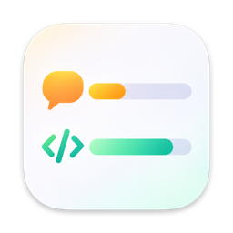
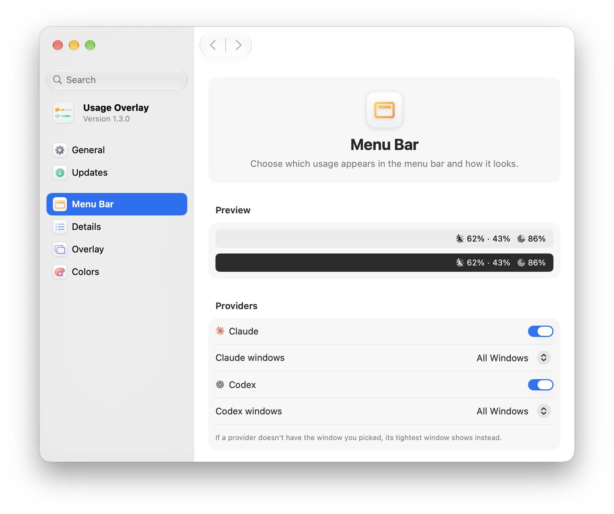

# Usage Overlay

<picture>
  <source media="(prefers-color-scheme: dark)" srcset="docs/overlay-dark.png">
  
</picture>

## Overview

Usage Overlay is a macOS menu bar app that keeps your **Claude** and **Codex** rate-limit usage in view. For each rate-limit window it shows how much is left and when the window resets, in three places:

- **Menu bar**: each provider's logo and what's left. The logo doubles as a clock for the time until reset.
- **Details menu**: every window with a bar, its reset time, and your plan.
- **Overlay**: an optional floating panel that stays above other windows.

Bars turn amber below 50% left and red below 20% left.

## Quick start

1. Install and sign in to the CLI for each provider you use. Check with `claude auth status` and `codex login status`.
2. Download `Usage-Overlay-v*.zip` from the [latest release](https://github.com/ginjae/usage-overlay/releases/latest), unzip it, and move **Usage Overlay.app** to `/Applications`.
3. Open the app. Releases are ad-hoc signed rather than notarized, so macOS may block the first launch. If it does, go to **System Settings → Privacy & Security** and choose **Open Anyway**.
4. Your usage appears in the menu bar. Click it and choose **Show Overlay** to float the panel.

Requires macOS 14 or later, on Apple Silicon or Intel. Which windows you see depends on your account.

## How it works

### Where the numbers come from

The app runs the CLIs you're already signed in to and reads what they print. It finds them in their usual install locations, or at the paths you set in **Settings → General → Command-line tools**.

```bash
claude -p "/usage" --session-id <new UUID>   # Claude Code: usage
claude auth status                           # Claude Code: plan name, once per launch
codex app-server                             # Codex: usage and plan, over JSON-RPC
```

`/usage` is built into Claude Code, so no prompt goes to a model. The app deletes the transcript that the one-off session leaves in `~/.claude/projects`.

Codex has no usage subcommand, so the app starts the same app server the Codex TUI uses and writes these lines to its stdin:

```json
{"id":0,"method":"initialize","params":{"clientInfo":{"name":"usage-overlay","version":"1.0.0"}}}
{"method":"initialized"}
{"id":1,"method":"account/rateLimits/read"}
```

It refreshes every 5 minutes (**Settings → General**) and pauses while the Mac or display sleeps. A provider's CLI runs only while that provider is shown in the menu bar, the details menu, or a visible overlay.

### Menu bar and details

<picture>
  <source media="(prefers-color-scheme: dark)" srcset="docs/menubar-dark.png">
  
</picture>

By default the menu bar shows every window for each provider. In **Settings → Menu Bar** you can show one window or the **Tightest Window** (the one with the least left), add labels such as `5h 39%`, or switch to **Percent Used**.

<picture>
  <source media="(prefers-color-scheme: dark)" srcset="docs/details-dark.png">
  
</picture>

Click the menu bar item for the details menu. It lists each window's time to reset and the weekday and time it resets. Turn on **Pace** in **Settings → Details** to see whether your current rate will use up a window before it resets. Codex plans **Pro 100**, **Pro 200**, and **Pro 500** are the [ChatGPT Pro tiers](https://learn.chatgpt.com/docs/pricing) at $100, $200, and $500 a month.

### Overlay

The overlay starts hidden and shows **5-hour** and **Weekly** for each provider. It floats above other windows on every Space, including full screen, and stays where you drag it. Set its opacity, click-through, columns, size, and background in **Settings → Overlay**. On macOS 26 and later, the background options include Liquid Glass.

### Settings

<picture>
  <source media="(prefers-color-scheme: dark)" srcset="docs/settings-dark.png">
  
</picture>

Settings is laid out like System Settings. Search the sidebar to find the pane for any setting, and press ⌘[ and ⌘] to go back and forward. Changes apply right away, and every pane except **Updates** has its own **Restore Defaults**.

| Pane | What you can change |
|---|---|
| **General** | Launch at login, refresh interval, provider order, CLI locations |
| **Updates** | Installed version, release notes, automatic checks |
| **Menu Bar** | Windows, percent left or used, reset time, appearance, tooltip |
| **Details** | Windows, percent left or used, which lines to show, width |
| **Overlay** | Visibility, opacity, click-through, position lock, windows and columns, size, background, Spaces |
| **Colors** | Level colors and where each starts, provider logo colors |

In **Details** and **Overlay**, **Selected Windows** lets you pick each provider's windows one by one.

### Updates

Once a day the app checks GitHub for a new version and asks before installing it. It verifies the download against its SHA-256 checksum when one is published, checks the app identifier and version, then replaces itself and reopens. Your settings are kept. A red badge in the Settings sidebar marks a new version, and **Settings → Updates** shows what's new. The app has to be in a folder it can write to, such as `/Applications`.

### Privacy

The app's own network requests are GitHub release checks and update downloads. They carry no usage data or credentials. Usage is queried by the CLIs with their own sign-in; the app reads their output and never reads stored credentials. There is no telemetry. You can turn off update checks in **Settings → Updates**.

## Troubleshooting

- **A provider says its CLI wasn't found.** Point to it in **Settings → General → Command-line tools**.
- **The numbers look old.** The details menu and the overlay show when they were updated. Use **Refresh Now** or the overlay's refresh button.
- **The overlay won't move.** Turn off **Click through** and **Lock position** in **Settings → Overlay**, or use **Reset Overlay Position** in the menu.
- **An update won't install.** Move the app to `/Applications` and open it again.

## Build from source

Requires Swift 6 or later, from Xcode or its Command Line Tools. Build with Xcode 26 or later to get the Liquid Glass look on macOS 26 and later. With an older SDK the app keeps the previous look, and the script warns about it.

```bash
./scripts/bundle.sh               # → build/Usage Overlay.app
./scripts/bundle.sh --universal   # Apple Silicon and Intel
swift test
```

Set `APP_VERSION` and `BUILD_NUMBER` for the bundle's version (defaults: `0.1.0` and `1`). The tests run against a small local CLI fixture and never query your accounts.

[About the screenshots](docs/README.md)
