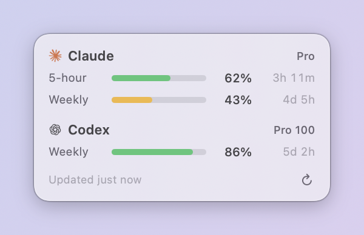
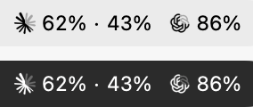
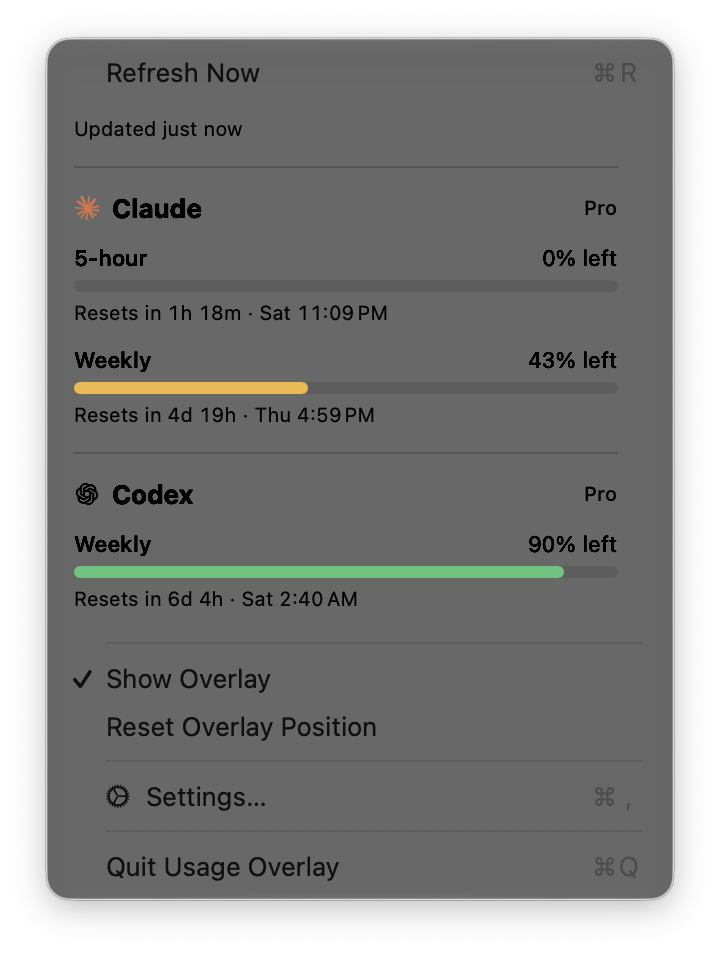

# Usage Overlay

A macOS menu bar app that keeps your **Claude** and **Codex** rate-limit usage on screen at all times.



By default, each row shows one rate-limit window: **how much of it is left**, and the time until it resets. For example, 39% means 39% is still available. You can switch to **Percent Used** separately for the menu bar, details, and overlay. Bars turn amber below 50% remaining and red below 20% remaining, whichever percentage you display. The thresholds and colors can be changed in **Settings → Colors**.

The menu bar defaults to **All Windows** for each provider, with window labels hidden and **Logo Clock** for reset time. Choose a specific window or **Tightest Window** (the one with the least headroom) in **Settings → Menu Bar**. Window labels are optional: with short labels, `5h 39%` means 39% of the 5-hour window is left, and `7d 62%` means 62% of the weekly window is left.

The **Menu Bar → Preview** shows your configuration on light and dark backgrounds:



The numbers come from the CLIs you already have. The default refresh interval is 5 minutes; change it under **Settings → General**. Polling pauses while the Mac or display sleeps, or your login session is inactive, and resumes when active. Usage checks query quota information without asking a model to generate a response.

If a provider is enabled only in the overlay, hiding the overlay pauses that provider's usage queries until the overlay is shown again.

## Install

Download `Usage-Overlay-v*.zip` from the [latest release](https://github.com/ginjae/usage-overlay/releases/latest), unzip it, and move **Usage Overlay.app** to `/Applications`.

You need macOS 14 or later. Release downloads run natively on Apple Silicon and Intel Macs. Install and sign in to the CLI for each provider you use — check with `claude auth status` and `codex login status`. Only use one provider? Turn the other off in **Settings** under **Menu Bar**, **Details**, and **Overlay**, and its CLI will not be run. Available rate-limit windows depend on your account.

Releases are ad-hoc signed rather than notarized, so macOS may block opening the app. After trying to open it, go to **System Settings → Privacy & Security → Security → Open Anyway** if macOS offers that option.

[Screenshot details](docs/README.md) record the captured build and configuration.

## Details and settings

Click the menu bar item for the details. **Refresh Now** sits at the top, followed by the last updated time and a divider, then each enabled provider's usage and reset times. Reset times always use the weekday and local time. Hide the timestamp with **Settings → Details → Last updated**. Turn on **Pace** in the same pane to project whether your current usage rate will exhaust a window before it resets. Below the usage are **Show Overlay**, **Reset Overlay Position**, **Settings…** and **Quit Usage Overlay**.



Codex plan labels use **Pro 100**, **Pro 200**, and **Pro 500** for the ChatGPT Pro subscriptions at **$100**, **$200**, and **$500 per month**. See the official [pricing](https://learn.chatgpt.com/docs/pricing) and [Pro tier names](https://learn.chatgpt.com/docs/dots#access) (checked November 4, 2026).

Settings is laid out like System Settings: search the sidebar to find a pane by any of its rows, and go back and forward between panes with ⌘[ and ⌘]. Settings apply as you change them:

| Pane | What you can change |
|---|---|
| **General** | Launch at login, refresh interval, provider order, where the CLIs are |
| **Updates** | Installed version, update status and release notes, automatic checks |
| **Menu Bar** | Providers and windows, percentage display, reset time, appearance, spacing, the hover tooltip |
| **Details** | Providers and windows, percent left or used, each line (plan, bar, time to reset, reset time, pace, last updated), width |
| **Overlay** | Visibility, opacity, click-through, locked position, providers and windows, each column, width, text size, bar thickness, background, corners, border, Spaces, staying on top |
| **Colors** | The three level colors and where each starts, and the provider logo colors |

Every pane except **Updates** has **Restore Defaults** for that pane alone.

In **Details** or **Overlay**, choose **Selected Windows** under a provider to turn individual windows on or off — for example, show **5-hour** and **Weekly** while hiding **Fable**. Each pane and provider keeps its own selection. Only windows available on your account are displayed.

The overlay starts hidden; enable it with **Show Overlay** in the menu. Its default selection is **5-hour** and **Weekly** for each provider. When shown, it floats above other windows on every Space, including full screen. Drag it by its background; it remembers where you left it. Existing saved preferences are preserved when updating.

## Updates

The installed app checks for a new version once a day by default and asks before installing one — **Update**, **Later**, or **Skip This Version**. It compares the archive with a SHA-256 checksum when one is available, checks the app identifier and version, then replaces itself and reopens. When a new version is out, a red badge and **Update Available** appear at the top of the Settings sidebar. **Settings → Updates** shows what's new and installs it with **Update Now**; opening it also checks for a new version, unless automatic checks are off. Run a check yourself with **Check Now**, or turn off automatic checks, in the same pane. Self-updates require write access to the app's containing folder and cannot run from a read-only, translocated copy.

## Privacy

Usage Overlay's own network requests are GitHub release checks and update downloads. Those requests do not include your usage data or CLI credentials. Usage queries are performed by the signed-in CLIs using their existing credentials; the app reads their output rather than accessing stored credentials. It does not upload usage data or telemetry. Automatic update checks can be turned off in **Settings → Updates**.

## If something looks wrong

- **A row says the CLI wasn't found.** It is installed somewhere unusual. Point at it under **Settings → General → Command-line tools**; the line under each path shows which file is in use.
- **An update won't install.** The app can only replace itself where it can write, and not while macOS runs it from a read-only copy. Move it to `/Applications` and open it again.
- **The numbers look old.** The details menu and the overlay footer show their age. Refresh from **Refresh Now** in the menu or the overlay's refresh button.
- **A selected window shows another window instead.** That window is not available in the current response, so the app falls back to the provider's tightest window.
- **The overlay won't move.** Turn off **Click through** and **Lock position** under **Settings → Overlay**. Use **Reset Overlay Position** in the menu to move it back to the primary display's top-right corner.

## Build from source

Requires macOS and Swift 6 or later, provided by Xcode or its Command Line Tools.

```bash
xcode-select --install     # if the build tools are missing
./scripts/bundle.sh        # → build/Usage Overlay.app
```

Run `./scripts/bundle.sh --universal` to build for both Apple Silicon and Intel. Open the resulting app from `build`, or copy it to `/Applications`.

Set `APP_VERSION` and `BUILD_NUMBER` when you need specific bundle version metadata; the script defaults to `0.1.0` and `1`.

Run `swift test` for regression checks covering CLI timeouts, process cleanup, output limits, and provider visibility. Tests compile a small local CLI fixture with `xcrun clang`; they do not query your Claude or Codex accounts.
